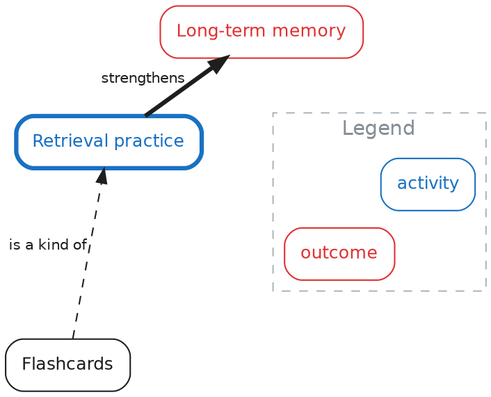

# Concept-map profile

A concept map is a diagram whose shapes are concepts and whose arrows are named relations between them. The user studies these maps with spaced repetition, so positions are frozen and the look must be consistent from map to map. Use `--profile concept-map` with `$TOOLS` for any `[map]` note.

## Conventions

| Convention | How it is drawn | Checked |
|---|---|---|
| Every relation is named | each arrow has a short verb phrase as `label` (`causes`, `is part of`, `enables`) | yes: an unnamed arrow is a warning |
| The most important concepts and relations stand out | `penwidth=3` on those shapes and arrows; everything else default | no: agree the choice with the user |
| "Is a kind of" is dashed | `style=dashed` on arrows labelled `is a`, `is a kind of`, `is a type of`; dashed is used for nothing else | yes, both ways |
| Colours mark roles | `color` and `fontcolor` (the same value) from: blue `#1971c2`, green `#2f9e44`, red `#e03131`, plain `#1e1e1e` | yes: any other colour is a warning |
| A legend explains the meaning | when any colour or dashed line is used, a group titled `Legend` holds one sample shape per colour (labelled with its role) | yes: a missing legend is a warning |

What each colour means is chosen per map and written in its legend. The usual choice, from the maps made before November 2026, is blue = activity, green = process, red = outcome.

Warnings never block a save (REQUIREMENTS R13.5.9): show them with the change list and let the user decide.

## Draft template

Use `layout=fdp` when the map has groups (the legend is one), `neato` otherwise. Link a concept to its zettel with `URL="id:<noteId>"`.

## When editing

- New concept: `"add"` with `near` the concept it relates to; set `color` and `textColor` together for a role, `penwidth: 3` for a key concept.
- New relation: `"relate"` with a `label`; `"line": "dashed"` only for "is a kind of".
- A new role colour needs a new sample in the legend group — that needs **Edit layout**, since new shapes are placed outside groups. Tell the user.
