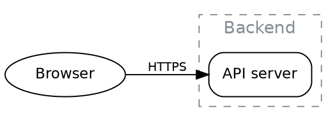

# Drafting DOT for a new diagram

`diagram.mjs create` lays out a draft once with Graphviz and freezes every position. Write the draft without positions; everything else in it is stored as written.

## Skeleton

- The first line names the diagram: `// Diagram: <name>`. The name is the title without prefix or timestamp.
- **IDs** are short slugs of the label (`api`, `job_worker`); the label holds the text. Never use `key` as an attribute: Graphviz reserves it.
- Use `fontname=Helvetica` everywhere: the canvas and the renderer both draw it.

## Choosing a layout

| Layout | For | Notes |
|---|---|---|
| `dot` | architecture, flows, pipelines, hierarchies | `rankdir=LR` or `TB`; groups (`subgraph cluster_*`) are respected; `compound=true` with `lhead`/`ltail` for arrows to a group |
| `fdp` | concept maps, idea pictures **with groups** | `overlap=false sep="+20" splines=true`; raise `K` (e.g. `1.2`) to spread it out |
| `neato` | concept maps and networks **without groups** | `overlap=false sep="+20" splines=true`; it ignores groups, so a group frame can cover other shapes |

If `create` warns about overlaps or a frame covering a shape, change the layout or its spacing and run it again; don't accept a diagram with overlaps.

## What can be stored

Only what the canvas can show survives an **Edit layout** session, so use only these:

- **Shapes:** `shape=box` (with `style=rounded` for rounded corners), `ellipse`, `diamond`, `plaintext` (text without a box).
- **Look:** `color`, `fillcolor` with `style=filled`, `penwidth`, `style=dashed|dotted`, `fontcolor`, `fontsize`. Colours as `#rrggbb` (or `#rrggbbaa` for transparency).
- **Arrows:** `label`, `dir=none|back|both` (default forward), `arrowhead`/`arrowtail` (`normal`, `vee`, `onormal`, `dot`, `odot`, `tee`, `diamond`, `odiamond`, `crow`).
- **Groups:** `subgraph cluster_<id> { label=... }`. Groups can nest.
- **Links:** `URL="id:<noteId>"` makes a shape open a Trilium note; `URL="https://..."` a web page.
- **Line breaks:** `\n` inside a label. Graphviz doesn't wrap text, so break long labels yourself (about 25 characters a line).

Not stored, so don't use: HTML labels, `record` shapes, images, icons, edge ports, `rank=same` tricks you rely on later (the layout is frozen anyway), and the old legend attributes `kind`, `main`, `rel`, `convention`.

## Good diagrams

- One idea per diagram; split a big picture into several.
- Short labels: nouns for shapes, verbs for arrows.
- A colour or line style that means something gets a group titled `Legend` that explains it.
- Bold (`penwidth=3`) is for the few things that matter most, never for everything.
